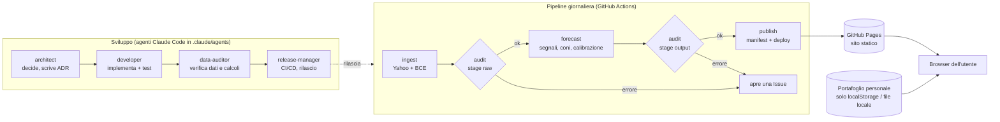
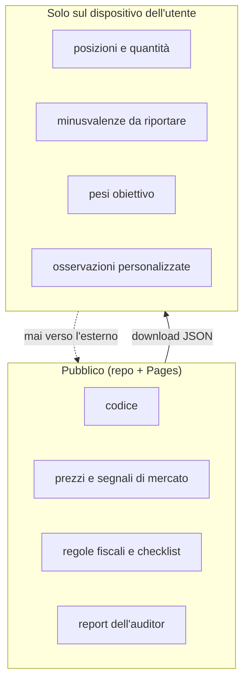

# 02 · Architettura

Decisioni motivate nelle ADR in [`docs/adr/`](adr/). Ruoli degli agenti in [`04-agenti.md`](04-agenti.md).

## Principi

1. **Privacy prima di tutto.** Il repo è pubblico (serve a Pages gratuito), quindi i dati personali non vi entrano mai: il portafoglio vive solo nel browser e può essere esportato in un file locale.
2. **Costo zero.** Solo GitHub Pages + GitHub Actions su repo pubblico, nessuna chiave API a pagamento.
3. **Nessun dato senza controllo.** Un agente auditor blocca la pubblicazione se i dati non superano i controlli.
4. **Scenari, non verdetti.** Le previsioni sono distribuzioni con affidabilità misurata, non ordini di acquisto o vendita.
5. **Ogni regola fiscale ha fonte e data.** Se invecchia, l'auditor lo segnala.

## Vista d'insieme



## Confini di fiducia



Il browser carica script e stili **solo dal proprio dominio** (CSP `default-src 'self'`): nessun tracker, nessun CDN. I calcoli sul portafoglio avvengono tutti nel browser.

## Pipeline dati (agenti di runtime)

Ogni passo è un sottocomando di `fd_pipeline` e un job del workflow `pipeline.yml`. I job passano i dati come artifact e sono collegati da *gate* (`needs` + codice di uscita).

| Passo | Ingresso | Uscita | Gate |
|---|---|---|---|
| `ingest` | `data/universe.json`, `store/` (branch `data`) | `store/prices/<ID>.csv`, `store/fx.json`, `store/ingest_log.json` | Errori per singolo strumento registrati, non bloccanti |
| `audit --stage raw` | store + universe + regole | `build/site/data/audit.json` | **Blocca** se ci sono errori |
| `forecast` | store | `signals.json` (segnali, coni, calibrazione) | Salta gli strumenti con storico insufficiente |
| `audit --stage output` | `signals.json`, regole, `fx.json` | `audit.json` aggiornato | **Blocca** se ci sono errori |
| `publish` | tutto | `manifest.json`, sito in `build/site`, commit del branch `data`, deploy Pages | Solo se i due audit sono passati |

Se un gate fallisce, il job `report-failure` apre (o aggiorna) una Issue con etichetta `data-audit-failed` e il sito online **resta alla versione precedente**.

### Controlli dell'auditor

Stage `raw`: schema e ordinamento delle serie, prezzi positivi e finiti, freschezza (avviso oltre 4 giorni lavorativi, errore oltre 10), storico minimo, buchi, outlier per classe, serie "congelate", checksum degli ISIN, id unici, cambi presenti e positivi, schema e scadenza delle regole fiscali (avviso oltre 180 giorni dall'ultima verifica, errore oltre 365).

Stage `output`: tutti gli strumenti con storico sufficiente hanno segnali, quantili ordinati e finiti, calibrazione della fascia 10°–90° tra 60% e 95% (altrimenti avviso: modello poco affidabile), manifest coerente e dimensioni sotto soglia, scansione di pattern sensibili (IBAN) nei dati pubblicati.

Esito complessivo: `pass`, `warn` (si pubblica, la dashboard mostra un avviso) oppure `fail` (non si pubblica).

## Contratti dei dati pubblicati (`build/site/data/`)

| File | Contenuto |
|---|---|
| `universe.json` | Elenco strumenti (id, nome, ISIN, ticker, valuta, classe, tipo fiscale, TER) |
| `signals.json` | Per strumento: rendimenti 1/3/6/12 mesi, volatilità, drawdown, trend, momentum, serie settimanale ridotta, cono di scenario a 12 mesi, probabilità di perdita, calibrazione |
| `fx.json` | Cambi BCE: unità di valuta per 1 EUR |
| `rules.json` | Regole fiscali/burocratiche e checklist per tipo di strumento |
| `audit.json` | Esito dei controlli per stage, con dettaglio |
| `manifest.json` | Versione dello schema, data di generazione, hash e dimensione dei file |

`schema_version` è nel manifest: il front-end rifiuta versioni che non conosce.

## Front-end

Sito statico senza build e senza dipendenze di terze parti, moduli ES nativi.

| Modulo | Responsabilità |
|---|---|
| `tax.js` | Funzioni pure: imposta su plusvalenze per tipo di strumento, riporto minusvalenze con scadenza a 4 anni, bollo/IVAFE, stima FTT |
| `portfolio.js` | Validazione, salvataggio locale, import/export JSON, valorizzazione con prezzi e cambi |
| `insights.js` | Osservazioni su concentrazione, pesi obiettivo, costi, minusvalenze in scadenza, obblighi dichiarativi, scenari |
| `charts.js` | Grafici SVG (linea + cono di scenario, barre) |
| `app.js` | Schede: Panoramica, Mercati e scenari, Fisco e burocrazia, Stato dei dati |

## Struttura del repository

```
finance-dashboard/
├─ .claude/agents/        agenti di sviluppo (architect, developer, data-auditor, release-manager)
├─ .github/workflows/     ci.yml (test su PR), pipeline.yml (dati + deploy)
├─ data/                  universe.json, compliance/rules.json (versionati)
├─ docs/                  ricerca, architettura, ADR, agenti, roadmap
├─ pipeline/              fd_pipeline (Python: numpy + libreria standard) + test
├─ tools/                 privacy_guard.py, build_site.py
├─ web/                   front-end statico + test (node:test)
├─ build/                 uscita locale (ignorata da git)
└─ store/                 storico prezzi locale (ignorato; in CI è il branch `data`)
```

## Rischi e mitigazioni

| Rischio | Mitigazione |
|---|---|
| Yahoo cambia o blocca l'endpoint | Interfaccia `PriceProvider`, audit di freschezza, Issue automatica, sito fermo alla versione precedente; seconda fonte in roadmap |
| Regola fiscale obsoleta | `last_verified` + soglie dell'auditor + livello di verifica visibile |
| Dati personali nel repo pubblico | `tools/privacy_guard.py` in CI, `.gitignore`, ADR-0001 |
| Previsione scambiata per certezza | Fasce, non punti; calibrazione storica mostrata; disclaimer fisso |
| Workflow `schedule` disattivato | Commit giornaliero sul branch `data`; da osservare |
