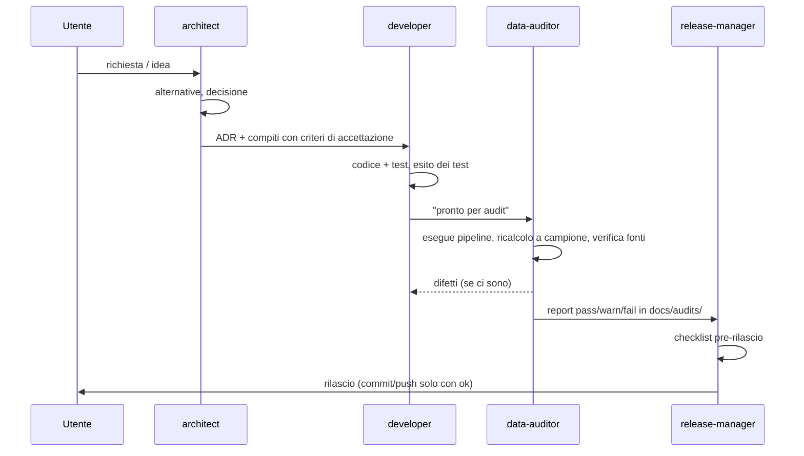

# 04 · Agenti

Due livelli, stessi quattro ruoli (vedi [ADR-0005](adr/0005-architettura-multi-agente.md)).

## Agenti di sviluppo (Claude Code, `.claude/agents/`)

| Agente | Ruolo | Scrive in | Modello |
|---|---|---|---|
| `architect` | Chiarisce, confronta alternative, **decide**, scrive ADR e compiti con criteri di accettazione | `docs/` | opus |
| `developer` | Implementa il compito con test, esegue i test, non tocca i workflow | `pipeline/`, `web/`, `data/` | sonnet |
| `data-auditor` | **Controlla tutti i dati** in modo indipendente, ricalcola a mano un campione, verifica le regole fiscali su fonti ufficiali, scrive il report. Non corregge | `docs/audits/` | sonnet |
| `release-manager` | Porta in produzione: workflow, privacy guard, Pages, rollback, gestione dei deploy falliti | `.github/`, `tools/` | sonnet |

### Protocollo di passaggio

Regola di separazione: chi scrive il codice non approva i propri dati; l'auditor non corregge; il release-manager non rilascia senza report.

### Come invocarli

In Claude Code basta nominarli, per esempio:

- "Usa l'agente `architect` per decidere come aggiungere i BTP al progetto."
- "Usa `developer` per implementare il compito 3 dell'ultima ADR."
- "Usa `data-auditor` per controllare i dati prima del rilascio."
- "Usa `release-manager` per preparare il rilascio."

## Agenti di runtime (GitHub Actions, gratuiti)

Eseguono codice deterministico: nessun modello linguistico, nessuna chiave API.

| Passo | Job in `pipeline.yml` | Comando | Gate |
|---|---|---|---|
| ingest | `ingest` | `python -m fd_pipeline ingest` | non bloccante per singolo strumento |
| auditor (dati grezzi) | `audit-raw` | `python -m fd_pipeline audit --stage raw` | **blocca** se `fail` |
| forecast | `forecast` | `python -m fd_pipeline forecast` | — |
| auditor (uscite) | `audit-output` | `python -m fd_pipeline audit --stage output` | **blocca** se `fail` |
| publisher | `publish` | `python -m fd_pipeline publish` + deploy Pages | solo dopo i due audit |
| segnalazione | `report-failure` | apre una Issue `data-audit-failed` | su qualunque errore |

L'agente di sviluppo `data-auditor` e il passo di runtime `audit` hanno lo stesso scopo e controlli diversi: il primo è un giudizio indipendente con ricalcolo e verifica delle fonti; il secondo è una rete di sicurezza automatica a ogni esecuzione.

## Estensioni possibili

- Agente `compliance-curator` che confronta ogni mese `rules.json` con le fonti ufficiali e propone una pull request.
- Revisione automatica delle PR con Claude tramite GitHub Actions: richiede una chiave API a pagamento, quindi è opzionale e fuori dal perimetro gratuito.
